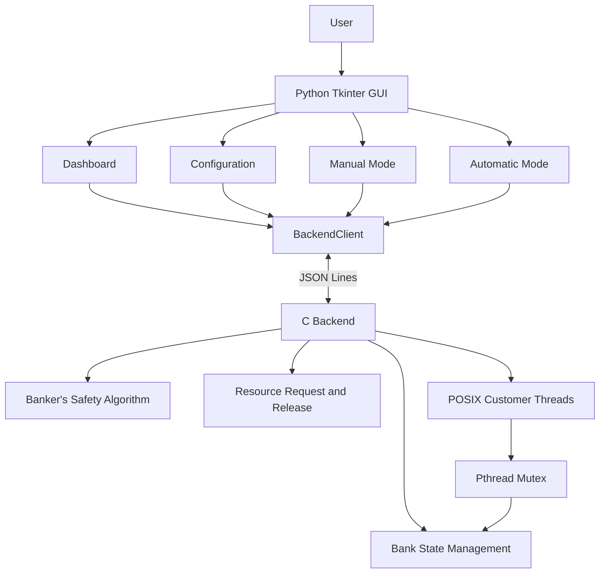

# Banker's Algorithm Resource Management Simulator

A dynamic **Banker's Algorithm Resource Management Simulator** developed using **C (C11), POSIX Pthreads, and Python Tkinter**. The project demonstrates deadlock avoidance, concurrent resource allocation, thread synchronization, and resource management through an interactive graphical interface.

The simulator allows users to configure customers and resource types dynamically, initialize a resource-allocation system, execute manual resource requests, and observe concurrent customer threads through an automatic simulation.

---

## 1. Overview

The Banker's Algorithm is a deadlock-avoidance algorithm used in operating systems to manage resource allocation among multiple processes.

This project implements a dynamic resource-management simulator that demonstrates how an operating system can determine whether granting a resource request will leave the system in a safe state.

The application consists of two major components:

- **C Backend:** Handles resource management, safety checking, resource requests, releases, and concurrent customer execution.
- **Python Tkinter Frontend:** Provides an interactive graphical interface for configuring the system, performing resource operations, and monitoring simulation activity.

The frontend and backend communicate using a JSON Lines protocol.

The simulator supports both manual resource allocation and automatic concurrent execution using POSIX threads.

---

## 2. Problem Statement

In a multiprogramming operating system, multiple processes may compete for a limited set of resources.

If resources are allocated without considering future requirements, the system may enter an unsafe state that can potentially lead to deadlock.

Traditional manual calculations of resource allocation and safe sequences can become difficult when the number of processes and resource types increases.

The objective of this project is to develop an interactive simulator that:

- Dynamically configures processes and resource types.
- Calculates available resources and remaining requirements.
- Determines whether the system is in a safe or unsafe state.
- Validates resource requests before granting them.
- Demonstrates concurrent resource requests using POSIX threads.
- Provides real-time visibility into resource allocation and thread activity.

---

## 3. Objectives

- Implement the Banker's Safety Algorithm.
- Dynamically allocate and manage resource matrices.
- Detect safe and unsafe system states.
- Validate resource requests before allocation.
- Implement rollback when a request results in an unsafe state.
- Demonstrate concurrent execution using POSIX Pthreads.
- Synchronize shared resource data using mutex locks.
- Develop an interactive graphical interface using Tkinter.
- Establish communication between C and Python using JSON Lines.
- Test the reliability of the backend and frontend.

---

## 4. Features

### Dynamic System Configuration

- Supports 1–50 customers.
- Supports 1–10 resource types.
- Allows users to configure total resources.
- Dynamically generates Maximum and Allocation matrices.
- Calculates the Need matrix and Available vector.

### Banker's Algorithm Implementation

- Implements the Safety Algorithm.
- Determines whether the current system state is safe or unsafe.
- Identifies a safe execution sequence when one exists.
- Validates resource requests against available resources and remaining needs.
- Rejects unsafe requests and restores the previous allocation state.

### Resource Management

- Allocates resources to customers.
- Releases allocated resources.
- Maintains updated resource availability.
- Performs resource validation before granting requests.

### Multithreading

- Creates concurrent customer threads using POSIX Pthreads.
- Allows multiple customers to request resources.
- Synchronizes shared resource data using mutex locks.
- Joins created threads after their execution.
- Handles partial thread creation and resource-release failures.

### Graphical User Interface

- Dashboard for system status and resource information.
- Configuration screen for dynamic initialization.
- Manual Mode for individual resource requests and releases.
- Automatic Mode for concurrent customer simulation.
- Live thread monitoring and activity logs.
- Safe and unsafe state indicators.

### Reliability

- Safe bank re-initialization.
- Strict JSON input validation.
- Resource request rollback.
- Partial thread creation reporting.
- Regression tests for backend and GUI behaviour.

---

## 5. Banker's Algorithm

The Banker's Algorithm is a deadlock-avoidance algorithm that checks whether granting a resource request can leave the system in a safe state.

### Data Structures

The simulator maintains the following resource-management structures:

| Structure | Description |
|---|---|
| Available | Number of currently available instances of each resource type |
| Maximum | Maximum resource demand declared by each customer |
| Allocation | Resources currently allocated to each customer |
| Need | Remaining resources required by each customer |

### Important Equations

**Need Matrix**

\[
Need[i][j] = Maximum[i][j] - Allocation[i][j]
\]

**Available Vector**

\[
Available[j] = Total[j] - \sum_i Allocation[i][j]
\]

### Safety Algorithm

The Safety Algorithm determines whether there is an execution order in which every customer can obtain its remaining resources and finish.

Steps:

1. Initialize the Work vector using Available.
2. Mark all customers as unfinished.
3. Find an unfinished customer whose Need is less than or equal to Work.
4. If such a customer is found, assume it completes and releases its allocated resources.
5. Add its Allocation to Work.
6. Mark the customer as finished.
7. Repeat until all customers finish or no eligible customer can be found.

If all customers can finish, the system is in a **safe state**.

Otherwise, the system is in an **unsafe state**.

### Resource Request Algorithm

When a customer requests additional resources:

1. Validate that the request is non-negative.
2. Check that the request does not exceed the customer's remaining Need.
3. Check that the requested resources are available.
4. Temporarily allocate the requested resources.
5. Run the Safety Algorithm.
6. If the resulting state is safe, commit the allocation.
7. Otherwise, roll back the temporary allocation and reject the request.

This ensures that unsafe resource requests are not committed.

---

## 6. System Architecture

The project follows a frontend-backend architecture.

### Architecture Components

**Python Tkinter Frontend**
- Handles user interaction.
- Displays system configuration and resource matrices.
- Provides manual and automatic simulation modes.
- Displays backend events and thread status.

**BackendClient**
- Manages communication between the frontend and C backend.
- Sends commands to the backend.
- Receives and processes JSON Lines responses.
- Provides backend events to the GUI.

**C Backend**
- Maintains the shared BankState.
- Performs resource allocation and release.
- Executes safety checks.
- Handles customer requests.
- Manages customer threads.

**POSIX Pthreads**
- Execute customer operations concurrently.
- Access shared resource data through synchronized backend functions.

### Architecture Diagram



---

## 7. Technology Stack

| Component | Technology | Purpose |
|---|---|---|
| Backend | C (C11) | Resource-management implementation |
| Concurrency | POSIX Pthreads | Concurrent customer execution |
| Synchronization | Pthread Mutex | Protects shared resource state |
| Frontend | Python | GUI application logic |
| GUI Framework | Tkinter | Interactive graphical interface |
| Communication | JSON Lines | Frontend-backend communication |
| Compiler | GCC | Compiles C backend |
| Build System | GNU Make | Backend compilation |
| Testing | Python unittest | Automated regression testing |

---

## 8. Project Structure

```text
bankers-algorithm-simulator/
│
├── src/
│   ├── main.c
│   ├── protocol.c
│   ├── banker.c
│   ├── safety.c
│   └── customer.c
│
├── include/
│   ├── banker.h
│   ├── customer.h
│   └── protocol.h
│
├── frontend/
│   ├── api.py
│   ├── main.py
│   ├── app.py
│   ├── dashboard.py
│   ├── configuration.py
│   ├── manual_mode.py
│   ├── automatic_mode.py
│   ├── styles.py
│   │
│   ├── test_api.py
│   ├── test_dashboard.py
│   ├── test_configuration.py
│   ├── test_manual_mode.py
│   ├── test_automatic_mode.py
│   ├── test_navigation.py
│   └── test_reliability.py
│
├── Makefile
├── README.md
└── .gitignore
```

### Backend Files

| File | Responsibility |
|---|---|
| main.c | Backend entry point |
| protocol.c | Handles JSON command processing and frontend communication |
| banker.c | Bank initialization, resource allocation, release, and state management |
| safety.c | Implements the Banker's Safety Algorithm |
| customer.c | Implements customer thread execution |

### Frontend Files

| File | Responsibility |
|---|---|
| main.py | Starts the GUI application |
| app.py | Main application window and screen navigation |
| api.py | Backend process management and communication |
| dashboard.py | Displays system status and resource information |
| configuration.py | Handles dynamic system configuration |
| manual_mode.py | Handles individual resource requests and releases |
| automatic_mode.py | Manages concurrent simulation and thread monitoring |
| styles.py | Defines GUI styling and reusable interface elements |

---

## 9. Application Modules

### Dashboard

Provides an overview of the initialized system.

Displays:
- Total customers.
- Number of resource types.
- Available resource pool.
- Current system safety status.
- Resource allocation information.
- Live activity and protocol events.

### Configuration

Allows users to initialize the Banker's Algorithm system.

Users can configure:
- Number of customers.
- Number of resource types.
- Total resource instances.
- Maximum resource matrix.
- Initial allocation matrix.

The backend calculates the Need matrix, Available vector, and system safety status.

### Manual Mode

Allows users to interact with the resource-management system manually.

Features:
- Select a customer.
- Enter a resource request.
- Submit a resource request.
- Release allocated resources.
- View updated resource availability.
- Observe whether the system remains safe.

### Automatic Mode

Demonstrates concurrent resource allocation using POSIX Pthreads.

Features:
- Configure customer request vectors.
- Generate safe baseline requests.
- Generate randomized requests.
- Start concurrent customer execution.
- Monitor individual customer thread states.
- View resource-grant and rejection events.
- Observe resource releases and final system state.

The Request Stop control requests graceful completion of the active simulation cycle. It does not forcibly terminate customer threads.

---

## 10. Concurrency and Synchronization

A major component of this project is demonstrating concurrent execution using POSIX Pthreads.

### Customer Thread Creation

In Automatic Mode, the C backend creates customer threads using:

```c
pthread_create()
```

Each customer thread performs its resource request independently.

### Shared Resource State

All customer threads access the shared BankState structure.

This structure maintains:
- Available resources.
- Maximum resource requirements.
- Current allocation.
- Remaining resource requirements.

### Mutex Synchronization

A Pthread mutex protects critical sections involving shared resource data.

The general synchronization process is:

1. A customer thread requests a mutex lock.
2. It accesses or modifies shared resource information.
3. The backend performs validation and safety checking.
4. The mutex is released.
5. Other threads can access the shared state.

This prevents simultaneous modifications from corrupting resource-management data.

### Thread Joining

The backend uses:

```c
pthread_join()
```

to wait for successfully created customer threads to finish.

After joining the threads, the backend reports simulation completion and the final resource state.

### Resource Release

When a request is granted, the customer thread holds the requested resources for its configured execution delay and then attempts to release them.

The release result is reported through backend events.

---

## 11. Installation and Setup

### Prerequisites

The following tools are required:

- GCC compiler
- GNU Make
- Python 3
- Tkinter
- POSIX-compatible operating system
- Git (optional, for cloning the repository)

The project is primarily developed and tested in an Ubuntu environment.

### Install Required Packages

On Ubuntu:

```bash
sudo apt update
sudo apt install build-essential python3 python3-tk git
```

Verify the installations:

```bash
gcc --version
make --version
python3 --version
```

Check Tkinter:

```bash
python3 -c "import tkinter; print('Tkinter available')"
```

---

## 12. Building and Running

### Step 1: Clone the Repository

```bash
git clone https://github.com/SarvaniVadavalli/bankers-algorithm-simulator.git
```

Navigate to the project directory:

```bash
cd bankers-algorithm-simulator
```

### Step 2: Compile the C Backend

```bash
make clean
make
```

The Makefile compiles the backend using GCC with C11 support, warning checks, optimization, and Pthread linkage.

### Step 3: Run the Complete GUI Application

From the project root:

```bash
python3 frontend/main.py
```

The frontend launches the graphical application and communicates with the C backend.

### Step 4: Use the Simulator

1. Open the Configuration screen.
2. Select the number of customers and resource types.
3. Generate the matrices.
4. Enter total resources, maximum requirements, and initial allocations.
5. Initialize the bank.
6. Navigate to the Dashboard.
7. Select Manual Mode or Automatic Mode.
8. Perform resource requests or run concurrent customer simulations.
9. Observe safety status, resource availability, and activity logs.

---

## 13. Testing

The project includes automated regression tests covering backend communication, GUI functionality, navigation, and reliability.

Run the complete test suite from the project root:

```bash
python3 -m unittest discover -s frontend -v
```

### Testing Coverage

| Test Area | What It Verifies |
|---|---|
| Backend API | Communication with the C backend |
| Configuration | Matrix generation and bank initialization |
| Dashboard | Display of system state and resource information |
| Manual Mode | Resource request and release behaviour |
| Automatic Mode | Concurrent simulation and thread monitoring |
| Navigation | Navigation between application screens |
| Reliability | Re-initialization, strict JSON validation, failure handling, and accurate thread status |

### Important Test Scenarios

**1. Safe State**

Verify that the Safety Algorithm identifies a valid safe sequence.

**2. Unsafe Resource Request**

Submit a request that would cause an unsafe state. Verify that the request is rejected and the previous state is restored.

**3. Resource Release**

Verify that successfully granted resources are released and the Available vector is updated.

**4. Concurrent Execution**

Run multiple customer threads and observe their execution, resource requests, and completion.

**5. Re-initialization**

Verify that a valid configuration replaces the previous bank and that a failed initialization preserves the existing bank state.

**6. Input Validation**

Verify that malformed JSON, invalid matrix dimensions, negative values, and integer overflow inputs are rejected.

**7. Thread Reliability**

Verify that partial thread creation and resource-release failures are reported accurately.

### Verified Test Result

The project regression test suite was executed successfully with:

- **60 automated tests passed.**
- Backend compilation completed without reported warnings or errors.

---

## 14. Example Scenarios

### Scenario 1: Safe System State

A configuration is initialized with sufficient available resources to allow customers to complete in a valid execution order.

Expected behaviour:
- Safety Algorithm identifies a safe sequence.
- System status displays SAFE STATE.
- Valid resource requests can be considered for allocation.

### Scenario 2: Unsafe Resource Request

A customer requests resources that are available but would result in an unsafe state if allocated.

Expected behaviour:
- Backend temporarily applies the request.
- Safety Algorithm detects the unsafe state.
- The request is rolled back.
- The request is rejected.
- The previous resource state is preserved.

### Scenario 3: Automatic Concurrent Simulation

Multiple customer threads request resources concurrently.

Expected behaviour:
- Customer threads are created using Pthreads.
- Shared resource data is protected using mutex synchronization.
- Requests are validated by the Banker's Algorithm.
- Granted resources are released after the execution delay.
- Threads are joined before final simulation completion is reported.

---

## 15. Limitations and Future Enhancements

### Current Scope

- The simulator supports a bounded number of customers and resource types.
- Automatic simulation executes a configured request workload.
- The Request Stop operation allows active customer threads to complete their current cycle and join rather than forcibly cancelling them.
- The application uses a local C backend and Python frontend communicating through JSON Lines.

### Future Enhancements

- More detailed visualization of resource allocation over time.
- Additional simulation workloads and configurable execution delays.
- Enhanced thread scheduling and execution controls.
- More detailed resource-utilization statistics.
- Improved error diagnostics and reporting.
- Additional concurrency and stress-testing scenarios.
- Cross-platform support where the required POSIX functionality is available.

---

## Conclusion

The Banker's Algorithm Resource Management Simulator demonstrates important Operating Systems concepts through an interactive application.

It combines deadlock avoidance, dynamic resource allocation, safety checking, concurrent execution, and mutex-based synchronization.

By integrating a C backend with a Python Tkinter frontend, the project provides a practical environment for understanding how resource allocation decisions affect system safety and how concurrent processes interact with shared resources.

---


